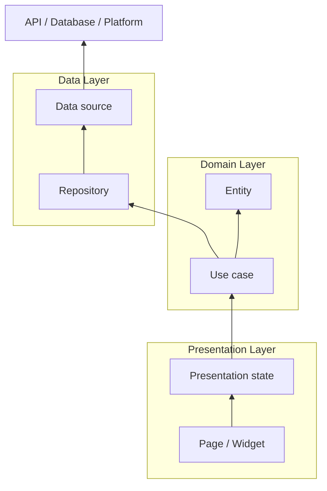

# Architecture

This page documents the project architecture and reusable shell in this Flutter template.

## Folder Structure

All source code lives in `lib/` and tests live in `test/`.

At the top level, the skeleton is split into:

- `lib/core/`: Cross-cutting code (settings persistence, theming, dependency wiring).
- `lib/pages/`: Feature modules. In this skeleton they are `page1` to `page6` and serve as examples.
- `lib/widgets/`: Globally reusable widgets (buttons, search bar, etc.).
- `lib/l10n/`: Generated localization code.

Within each feature module (example: `lib/pages/page1/`) keep the main files flat:

- `<feature>_datasource.dart`: data access boundary (API, DB, platform, etc.).
- `<feature>_repository.dart`: data-layer mapping and access.
- `<feature>_usecase.dart`: domain action used by the page.
- `<feature>_page.dart`: UI and presentation behavior.
- `entities/`: optional domain entities, such as `entities/item_entity.dart`.
- `widgets/`: optional feature-only widgets.

Keep a layer's files in the feature root while it has one small implementation. Create `data/`, `domain/`, `presentation/`, or layer-specific subfolders only when that layer grows to several related files. The primary feature files should generally stay near or below 500 lines; treat this as a review guideline and extract cohesive responsibilities when a file grows, rather than splitting code only to meet a line count.

As a simplified tree:

```text
├── assets
│   └── l10n
├── docs
│   └── wiki
├── lib
│   ├── core
│   │   ├── app_scope.dart
│   │   ├── injection.dart
│   │   ├── settings.dart
│   │   └── themes.dart
│   ├── l10n
│   ├── pages
│   │   ├── home
│   │   │   ├── page_navigator.dart
│   │   │   └── default_shell_config.dart
│   │   ├── page1
│   │   │   ├── page1_page.dart
│   │   │   ├── page1_datasource.dart
│   │   │   ├── page1_repository.dart
│   │   │   ├── page1_usecase.dart
│   │   │   └── entities
│   │   └── ...
│   └── widgets
└── test
```

## Layered Architecture

The skeleton uses a simple layered approach. Pages call use cases, which call repositories and datasources:

- Presentation contains pages and presentation controllers.
- Domain contains use cases and entities.
- Data contains repositories and datasources.
- Datasources talk to external systems.



### Presentation Layer

The Presentation layer is made of Flutter widgets (pages and shared widgets). It renders the UI and routes user interactions to the underlying logic.

### Application Layer

The Application layer holds UI-facing state and orchestration that should not live directly in the widgets.

In this skeleton:

- Feature pages use `StatefulWidget` for local UI state.
- Global app state is managed by `SettingsController` (a `ChangeNotifier`) and observed in `lib/main.dart`.

No BLoC pattern is used by this skeleton.

### Domain Layer

The Domain layer is represented by entities and use cases:

- Entities are immutable business models.
- Use cases provide entry points for UI actions and call repositories.

### Data Layer

The Data layer contains repositories and datasources. A datasource is the only place that should talk to external systems such as HTTP APIs, databases, or platform channels. A repository maps those results to feature entities.

## Dependency Injection

The skeleton uses GetIt as a service locator to keep object creation centralized and testable.

- DI container: `lib/core/injection.dart`
- Called from: `lib/main.dart`

`lib/core/injection.dart` registers:

- `SettingsController` (loaded from persistence at startup).
- Datasources, repositories, and use-cases per feature module.
- An `AppServices` aggregate used by the UI (`AppScope.of(context).services`).

The UI does not need to import GetIt directly: `AppScope` exposes `SettingsController` and `AppServices` down the widget tree.

## Add a feature

For a small feature such as `garden`, keep one file per layer in `lib/pages/garden/`:

```text
garden_page.dart
garden_datasource.dart
garden_repository.dart
garden_usecase.dart
```

Add `entities/` or `widgets/` only when the feature needs separate reusable files. Keep dependencies flowing from the page to the use case, repository, and datasource. For example, the data and domain classes can stay small and direct:

```dart
class GardenDataSource {
  Future<List<String>> loadNames() async => const ['Rose', 'Iris'];
}

class GardenRepository {
  final GardenDataSource dataSource;

  const GardenRepository({required this.dataSource});

  Future<List<String>> loadNames() => dataSource.loadNames();
}

class GardenUseCase {
  final GardenRepository repository;

  const GardenUseCase({required this.repository});

  Future<List<String>> call() => repository.loadNames();
}
```

Register the three objects in `lib/core/injection.dart` and add `GardenUseCase` to `AppServices`:

```dart
sl.registerLazySingleton<GardenDataSource>(GardenDataSource.new);
sl.registerLazySingleton<GardenRepository>(() => GardenRepository(dataSource: sl()));
sl.registerLazySingleton<GardenUseCase>(() => GardenUseCase(repository: sl()));
```

Have `GardenPage` call it through `AppScope.of(context).services.garden`. Register the page with the shell without editing shell widgets:

```dart
final defaults = defaultShellConfig();
final config = defaults.copyWith(
  destinations: [
    ...defaults.destinations,
    ShellDestination(
      id: 'garden',
      title: (_) => 'Garden',
      icon: Icons.local_florist_outlined,
      defaultViewId: 'garden',
      allowedViewIds: const {'garden'},
    ),
  ],
  views: [
    ...defaults.views,
    ShellViewRegistration(
      id: 'garden',
      title: (_, _) => 'Garden',
      destinationId: 'garden',
      viewBuilder: (context, _) => GardenPage(useCase: AppScope.of(context).services.garden),
    ),
  ],
);
```

Use the page's `ShellViewContext` for tab-specific breadcrumbs, right-sidebar sections, status items, toolbar actions, and workspace panes. Page 1 and the public extension test demonstrate those APIs.

## Adaptive shell

`lib/pages/home/home_page.dart` hosts the app shell. It adapts navigation and workspace layout to the platform and available width. Phones use bottom destination navigation; wider layouts use side navigation and a tab strip. At 800 px or wider a destination can show its activity panel, and at 1200 px or wider the right sidebar can dock beside the workspace. Below 1200 px the right sidebar opens as an end drawer. Each destination keeps an independent workspace and registered tabs.

The public shell descriptors and tab-scoped extension APIs live in `lib/pages/home/page_navigator.dart`. This file does not import placeholder feature pages. The default page registrations and private demo views live in `lib/pages/home/default_shell_config.dart`:

- `ShellDestination` registers a navigation destination with a stable ID, title, icon, optional default view, and optional activity panel.
- `ShellViewRegistration` registers content that can be opened in a workspace tab. A view may be associated with a destination, but destinations and tabs are separate concepts. The shell persists tab IDs and view registration IDs, and restores a tab only when its registration still exists.
- `ShellModule` registers selectable module content; `ShellContext` groups modules for a selectable context.
- `ShellViewContext` gives a page its tab-scoped controllers: `breadcrumbs`, `navigation`, `rightSidebar`, `status`, `toolbar`, and `workspace`.
- `ShellConfig.rightSidebarBuilder` supplies optional application-level sidebar content. A page can instead register `ShellRightSidebarSection` entries with its `rightSidebar` controller. `focusSection(id)` opens the sidebar and focuses that section.
- `ShellConfig.splitPaneBuilder` supplies application-level secondary content. A page can also request tab-scoped panes through its workspace controller.

Use `ShellBreadcrumbController` with stable `ShellNavigationNode` IDs to publish a page hierarchy. The shell shows the active path in the bottom status bar. Clicking a breadcrumb label opens its child menu; nested children open further menus. The active node IDs are saved with the owning tab. Page 1 is the working example. Pages can also publish tab-, destination-, and app-level status items through their status providers; the bar moves items that do not fit into its overflow menu.

The top toolbar search lists open tabs across destinations. The `+` tab action creates another instance of the current view (or the destination's default view). Profile and Settings are utility destinations in the navigation. The Settings destination displays `Page6SettingsPage`; the Profile destination uses the optional auth provider from `AppServices` and opens the template login page when signed out.

Pass a `ShellConfig` to `HomePage` to provide consuming-app content. The default configuration includes the six example destinations plus `profile` and `settings`. A custom configuration should register a `settings` destination if it should use the built-in Settings action.

## Local settings and themes

`SettingsController` stores JSON through SharedPreferences under `app_settings_json_v1`. Schema version 6 stores theme and text-scaling choices, locale, onboarding state, accent and density presets, navigation order and visibility, open tabs and workspaces, selected context/module, right-sidebar width and visibility, and split-pane state. Existing keys are retained during updates. Invalid individual values fall back to safe defaults; invalid JSON is not deleted automatically.

Theme colors are centralized in `AppShellTokens` and the Material color scheme in `lib/core/themes.dart`. System text scaling is always passed through from `MediaQuery`, including when an older saved preference requested no scaling.

## Continuous integration

`.github/workflows/flutter.yml` installs the Flutter version in `.fvmrc`, resolves dependencies, checks formatting and analysis, then runs each unit/widget test separately. It skips `shell_golden_test.dart` while the shell is being redesigned; golden reference images are not generated or updated in this workflow.
