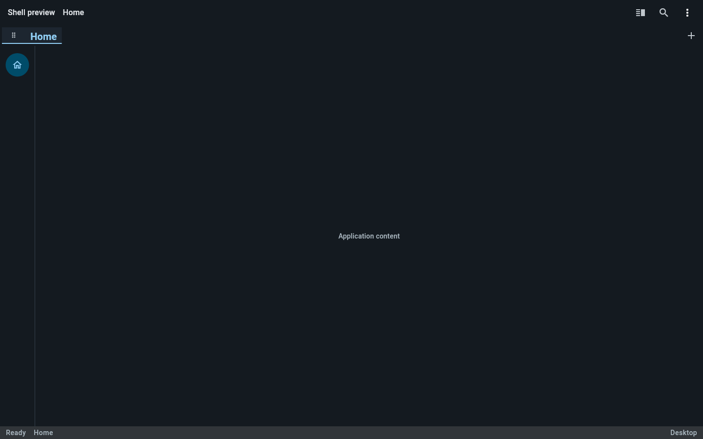
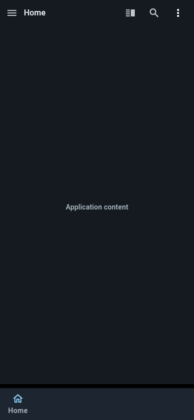

<h1 align="center">Flutter Template</h1>

<p align="center"><strong>One codebase. Six platforms. A head start on your next app.</strong></p>

<p align="center">
  A thoughtful Flutter foundation with an adaptive shell, reusable architecture, and the essentials already wired up.
</p>

<p align="center">
  <a href="https://github.com/domai-tb/flutter_template/actions/workflows/flutter.yml"></a>
  <a href="https://github.com/domai-tb/flutter_template/actions/workflows/docs.yml"></a>
  
  <a href="LICENSE.md"></a>
</p>

<p align="center"><strong>Android · iOS · macOS · Windows · Linux · Web</strong></p>

<p align="center">
  <a href="#features">Features</a> ·
  <a href="#screenshots">Screenshots</a> ·
  <a href="#quick-start">Quick start</a> ·
  <a href="#make-it-yours">Make it yours</a> ·
  <a href="#documentation">Documentation</a>
</p>

## Features

<table>
  <tr>
    <td width="50%"><strong>🧭 Adaptive app shell</strong><br>Reusable navigation, tabs, split views, and extension points.</td>
    <td width="50%"><strong>🧱 Feature-first structure</strong><br>Six example modules with clear data, domain, and presentation layers.</td>
  </tr>
  <tr>
    <td><strong>⚙️ App-wide services</strong><br>Dependency injection, persistent settings, and theming.</td>
    <td><strong>🌍 Ready for localization</strong><br>English and German strings managed through ARB files.</td>
  </tr>
  <tr>
    <td><strong>📱 Six-platform support</strong><br>Android, iOS, macOS, Windows, Linux, and web.</td>
    <td><strong>✅ Consistent development</strong><br>Flutter 3.47.2 pinned with FVM; CI runs formatting, analysis, and tests.</td>
  </tr>
</table>

## Screenshots

The adaptive shell at desktop and phone sizes.

<table>
  <tr><th>Desktop</th><th>App view</th></tr>
  <tr>
    <td></td>
    <td></td>
  </tr>
</table>

## Quick start

Install the pinned Flutter SDK, fetch dependencies, and launch the web app:

```sh
fvm install
fvm flutter pub get
fvm flutter run -d chrome
```

For mobile and desktop, set up the target platform and run `fvm flutter run`. Flutter will let you choose an available device. See the [platform setup guides](CONTRIBUTING.md#local-development-workflow).

## Make it yours

1. Replace the examples in `lib/pages/page1` through `page6` with your app's features.
2. Register feature dependencies in `lib/core/injection.dart` and expose use cases through `AppServices`.
3. Adapt `default_shell_config.dart` or pass your own `ShellConfig` to the shell.

The [architecture guide](docs/wiki/Architecture.md) walks through feature and shell registration.

## Project layout

| Path | Purpose |
| --- | --- |
| `lib/core/` | Shared services, settings, theme, and dependency injection |
| `lib/pages/home/` | App shell, navigation, and extension contracts |
| `lib/pages/page1/` … `lib/pages/page6/` | Example feature modules to replace |
| `lib/widgets/` | Reusable UI components |
| `assets/animations/` | JSON animation assets |
| `assets/img/` | App icon and splash artwork |
| `assets/l10n/` | English and German ARB localization files |
| `docs/` | Documentation and the GitHub Wiki build script |
| `docs/wiki/` | Guides and source pages for the published Wiki |

## Automation

The badges above show the latest status of the **Flutter CI** and **Documentation** workflows. CI checks changed Dart formatting, analyzes the project, and runs unit and widget tests on pushes and pull requests to `skeleton`. The documentation workflow builds and publishes the GitHub Wiki when the README or wiki sources change on that branch.

## Documentation

- [Getting started](docs/wiki/Getting_Started.md) · [Architecture](docs/wiki/Architecture.md)
- [Pages](docs/wiki/Pages.md) · [Utilities](docs/wiki/Utilities.md)
- [Published GitHub Wiki](https://github.com/domai-tb/flutter_template/wiki) · [Contributing](CONTRIBUTING.md)
- [Code of Conduct](CODE_OF_CONDUCT.md) · [Security policy](SECURITY.md) · [License](LICENSE.md)
