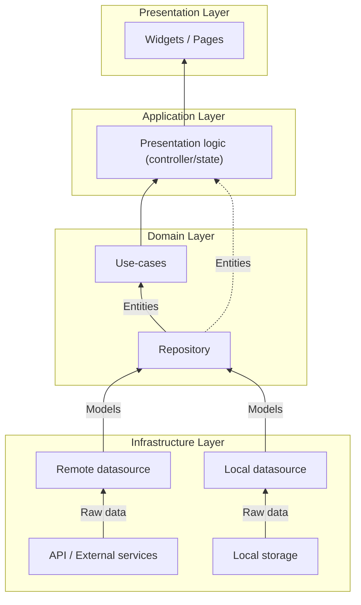

# Architecture

This page documents the project architecture and reusable shell in this Flutter template.

## Folder Structure

All source code lives in `lib/` and tests live in `test/`.

At the top level, the skeleton is split into:

- `lib/core/`: Cross-cutting code (settings persistence, theming, dependency wiring).
- `lib/pages/`: Feature modules. In this skeleton they are `page1` to `page6` and serve as examples.
- `lib/widgets/`: Globally reusable widgets (buttons, search bar, etc.).
- `lib/l10n/`: Generated localization code.

Within each feature module (example: `lib/pages/page1/`) we follow a small layered structure:

- `*_datasource.dart`: Data access boundary (API, DB, platform, etc.).
- `*_repository.dart`: Domain-friendly access and mapping.
- `*_usecases.dart`: Orchestration and business rules.
- `*_entity.dart`: Immutable data models used by the UI.
- `*_page.dart`: UI.

As a simplified tree:

```text
├── assets
│   └── l10n
├── docs
│   └── wiki
├── lib
│   ├── core
│   │   ├── app_scope.dart
│   │   ├── injection.dart
│   │   ├── settings.dart
│   │   └── themes.dart
│   ├── l10n
│   ├── pages
│   │   ├── home
│   │   ├── page1
│   │   ├── ...
│   │   └── pageN
│   └── widgets
└── test
```

## Layered Architecture

The skeleton uses a simple layered approach inspired by Clean Architecture. The exact naming is less important than the dependency direction:

- UI depends on use-cases.
- Use-cases depend on repositories.
- Repositories depend on datasources.
- Datasources talk to the outside world.



### Presentation Layer

The Presentation layer is made of Flutter widgets (pages and shared widgets). It renders the UI and routes user interactions to the underlying logic.

### Application Layer

The Application layer holds UI-facing state and orchestration that should not live directly in the widgets.

In this skeleton:

- Feature pages use `StatefulWidget` for local UI state.
- Global app state is managed by `SettingsController` (a `ChangeNotifier`) and observed in `lib/main.dart`.

No BLoC pattern is used by this skeleton.

### Domain Layer

The Domain layer is represented by entities, repositories, and use-cases:

- Entities are immutable data models used by the UI.
- Repositories abstract where data comes from and map raw data into domain entities.
- Use-cases provide an entry point for UI actions and orchestrate repository calls.

### Infrastructure Layer

The Infrastructure layer contains datasources. A datasource is the only place that should talk to external systems such as HTTP APIs, databases, or platform channels.

## Dependency Injection

The skeleton uses GetIt as a service locator to keep object creation centralized and testable.

- DI container: `lib/core/injection.dart`
- Called from: `lib/main.dart`

`lib/core/injection.dart` registers:

- `SettingsController` (loaded from persistence at startup).
- Datasources, repositories, and use-cases per feature module.
- An `AppServices` aggregate used by the UI (`AppScope.of(context).services`).

The UI does not need to import GetIt directly: `AppScope` exposes `SettingsController` and `AppServices` down the widget tree.

## Adaptive shell

`lib/pages/home/home_page.dart` hosts the app shell. It adapts navigation and workspace layout to the platform and available width. Phones use bottom destination navigation; wider layouts use side navigation and a tab strip. At 800 px or wider a destination can show its activity panel, and at 1200 px or wider the right sidebar can dock beside the workspace. Below 1200 px the right sidebar opens as an end drawer. Each destination keeps an independent workspace and registered tabs.

The public shell descriptors and tab-scoped extension APIs live in `lib/pages/home/page_navigator.dart`:

- `ShellDestination` registers a navigation destination with a stable ID, title, icon, optional default view, and optional activity panel.
- `ShellViewRegistration` registers content that can be opened in a workspace tab. A view may be associated with a destination, but destinations and tabs are separate concepts. The shell persists tab IDs and view registration IDs, and restores a tab only when its registration still exists.
- `ShellModule` registers selectable module content; `ShellContext` groups modules for a selectable context.
- `ShellViewContext` gives a page its tab-scoped controllers: `breadcrumbs`, `navigation`, `rightSidebar`, `status`, `toolbar`, and `workspace`.
- `ShellConfig.rightSidebarBuilder` supplies optional application-level sidebar content. A page can instead register `ShellRightSidebarSection` entries with its `rightSidebar` controller. `focusSection(id)` opens the sidebar and focuses that section.
- `ShellConfig.splitPaneBuilder` supplies application-level secondary content. A page can also request tab-scoped panes through its workspace controller.

Use `ShellBreadcrumbController` with stable `ShellNavigationNode` IDs to publish a page hierarchy. The shell shows the active path in the footer; selecting a breadcrumb opens its child menu, and deeper selections reveal the next level. The active node IDs are saved with the owning tab. Page 1 is the working example.

The top toolbar search lists open tabs across destinations. The `+` tab action creates another instance of the current view (or the destination's default view). Profile and Settings are utility destinations in the navigation. The Settings destination displays `Page6SettingsPage`; the Profile destination uses the optional auth provider from `AppServices` and opens the template login page when signed out.

Pass a `ShellConfig` to `HomePage` to provide consuming-app content. The default configuration includes the six example destinations plus `profile` and `settings`. A custom configuration should register a `settings` destination if it should use the built-in Settings action.

## Local settings and themes

`SettingsController` stores JSON through SharedPreferences under `app_settings_json_v1`. Schema version 6 stores theme and text-scaling choices, locale, onboarding state, accent and density presets, navigation order and visibility, open tabs and workspaces, selected context/module, right-sidebar width and visibility, and split-pane state. Existing keys are retained during updates. Invalid individual values fall back to safe defaults; invalid JSON is not deleted automatically.

Theme colors are centralized in `AppShellTokens` and the Material color scheme in `lib/core/themes.dart`. System text scaling is always passed through from `MediaQuery`, including when an older saved preference requested no scaling.
